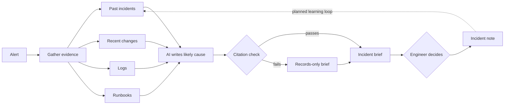

# Proplr Sentinel

Turns an IT alert into a short incident brief: the likely cause, related past incidents, recent changes and the known fix. The engineer on call checks the brief and decides what to do. Built for Brampton AI Innovator, Challenge 4. All data is made up.

## Run it

```powershell
python -m venv .venv
.venv\Scripts\python -m pip install -r requirements.txt
.venv\Scripts\python -m streamlit run app.py
```

For AI-written briefs, create a `.env` file in this folder. Never commit it.

```
OPENROUTER_API_KEY=your-key
```

Without a key, the app still works and builds each brief directly from the records.

## Demo scenarios

| Alert | Scenario | Expected brief |
|---|---|---|
| ALT-101, payments-api | Repeat incident | Matches INC-089 and its fix, RB-04 |
| ALT-102, checkout-service | Soon after a release | DEP-884 is the likely cause, no known fix |
| ALT-103, analytics-worker | New kind of alert | "No known fix found", with recent changes to check |

## How it works



The incident note and learning loop are planned and not built yet.

- `app.py`: the Streamlit app, AI fallback and citation check
- `backend/orchestrator.py`: gathers the evidence for an alert
- `backend/matching.py`: finds similar past incidents
- `backend/skill_runner.py`: calls the AI model
- `backend/skills/root-cause-agent/SKILL.md`: the AI's instructions
- `backend/data/`: sample alerts, incidents, changes, logs and runbooks
- `docs/solution-notes.md`: answers to the judges' likely questions

## Limits

The app runs on sample data only. It does not connect to live systems, run a fix, or send anything to anyone.
